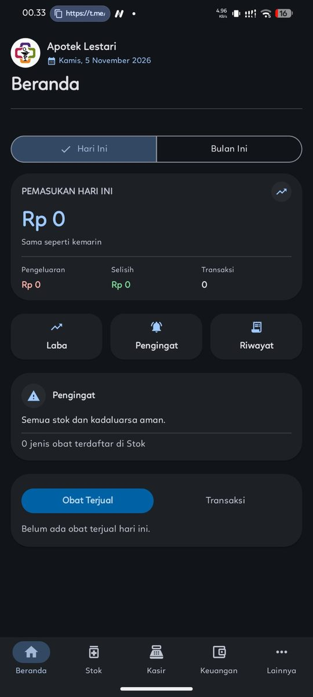
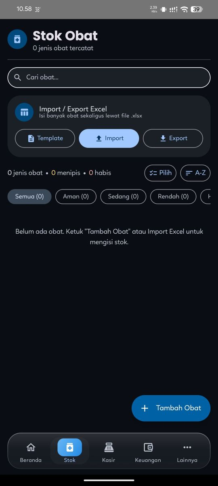
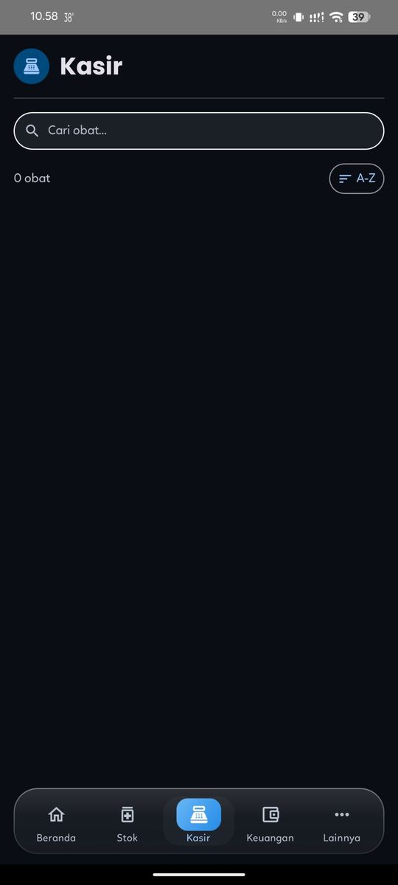
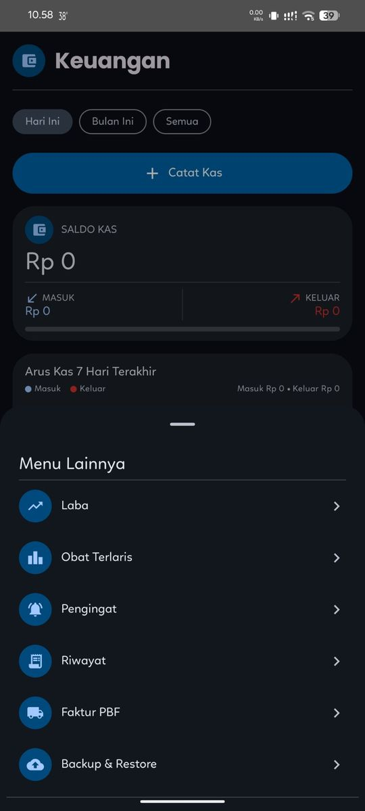
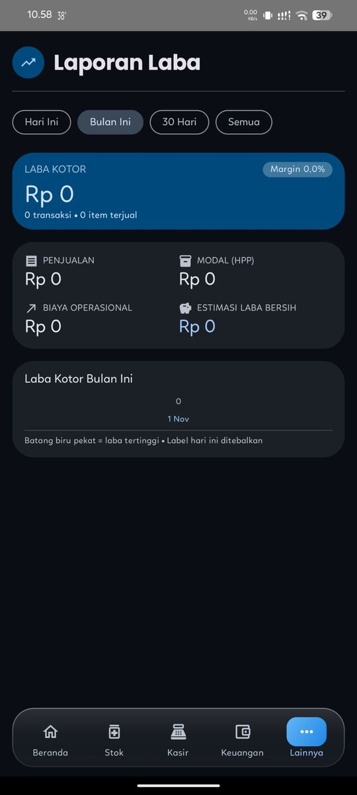
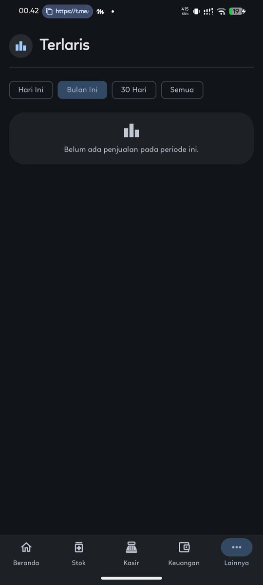
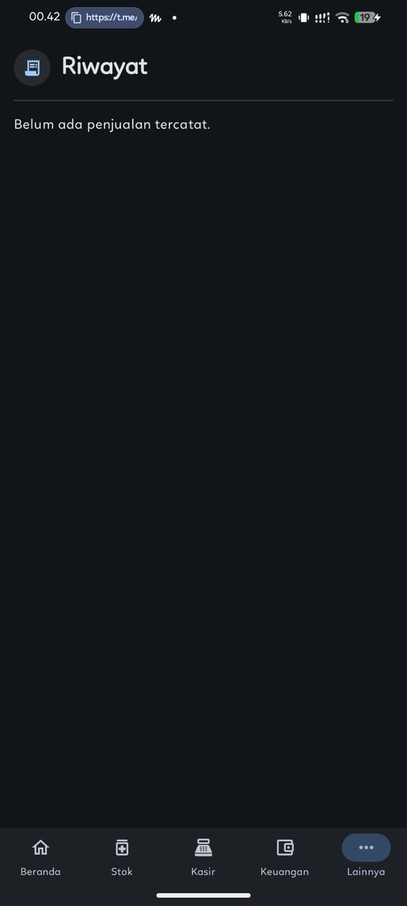
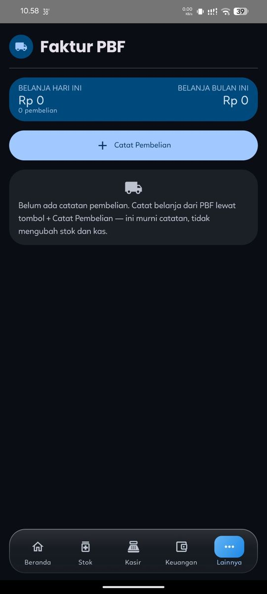

# Apotek Lestari — Pharmacy Cashier & Inventory Management App

An Android app for Apotek Lestari: sales cashier, medicine stock, cash book, profit reports, expiry/restock reminders, and purchase records from distributors (PBF) — **fully offline**, with all data stored on the device.

- **Technology:** Kotlin + Jetpack Compose (Material 3 Expressive), local Room/SQLite database
- **App version:** 1.0.0 — minimum Android 8.0 (API 26)
- **Time zone:** all "today / this month" boundaries use Asia/Jakarta (WIB)

## Screenshots

| Home | Medicine Stock |
|:---:|:---:|
|  |  |

| Cashier | Finance |
|:---:|:---:|
|  |  |

| More Menu | Profit Report |
|:---:|:---:|
|  |  |

| Best-Selling Medicines | Reminders |
|:---:|:---:|
|  |  |

| Sales History | Supplier Invoices (Faktur PBF) |
|:---:|:---:|
|  |  |

*Note: the screenshots show an earlier interface. The app has since moved to the official Material 3 Expressive design and components.*

## Menus & main features

- **Beranda (Home)** — today's sales summary with a "Pemasukan Hari Ini" (today's revenue) hero card, a money card (cash in / cash out / profit-loss), and combined reminders.
- **Kasir (Cashier)** — shopping cart, Cash/QRIS/Transfer payments, per-medicine Retail/Wholesale (Ecer/Grosir) pricing, and receipts carrying the "Semoga Cepat Sembuh" (get well soon) message.
- **Stok Obat (Medicine Stock)** — stock status Safe (16+) / Medium (10–15) / Low (1–9) / Out of stock (0), search & status filters, Excel import/export/template.
- **Keuangan (Finance)** — cash balance, cash in/out entries (Catat Kas), and a 7-day cash-flow chart.
- **Laporan Laba (Profit Report)** — profit per period with charts.
- **Obat Terlaris (Best-Selling Medicines)** — medicine ranking by units sold.
- **Pengingat (Reminders)** — low/out-of-stock medicines, medicines nearing expiry, and distributor bills nearing their due date.
- **Riwayat Penjualan (Sales History)** — daily history, invoice details, receipt sharing/printing.
- **Faktur PBF (Supplier Invoices)** — purchase records from distributors (Cash/Credit, VAT/PPN, due dates, mark-as-paid). Records only: they never change stock or cash.
- **Backup & Restore** — a single JSON file through the system file picker (can be saved to Google Drive).
- **Tentang Aplikasi (About)** — app version info.

Supporting features: receipt printing to Bluetooth thermal printers (ESC/POS, 58 mm paper), system printing/PDF via the Android print framework, dark/light themes, and invoice numbers in the `INV - dd/MM/yy` format (e.g. `INV - 01/11/26`).

## Tech stack

| Area | Technology |
|---|---|
| Language | Kotlin 2.2.20 |
| UI | Jetpack Compose — Material 3 Expressive (`material3` 1.5.0-alpha08, Compose BOM 2025.10.00) |
| Theme | `MaterialExpressiveTheme` + `MotionScheme.expressive()`; official components (`ShortNavigationBar`, `SegmentedButton`, chips, `ListItem`); color scheme generated with Google's Material Color Utilities algorithm (Expressive style, seed `#0061A4`, 2025 color spec) |
| Database | Room 2.7.2 (SQLite), fully offline |
| Excel | Apache POI 5.2.5 (`.xlsx` import/export/template) |
| Build | AGP 8.11.1, Gradle 8.13, compileSdk 36, targetSdk 34, minSdk 26 |
| Printing | Android PrintManager + ESC/POS over Bluetooth |

## How to build the APK

**Without a computer (the everyday flow):**

1. Open the **Actions** tab in this repo → the **Build APK** workflow → **Run workflow** on the `main` branch.
2. Download the **`app-release-apk`** artifact (signed release build, R8 — the one used day to day) or **`app-debug-apk`** (debug build) from the finished run page.
3. Install the APK on the phone/tablet.

**With Android Studio:** open the `kotlin-app/` folder, wait for Gradle Sync, then Build APK.

Build notes:

- Builds require internet access (Gradle dependency resolution).
- Release signing uses a keystore from a separate private repository (`Sigkey-Apotek-Lestari`), supplied through GitHub Actions secrets.

## Repository contents

- `kotlin-app/` — the Android project (Kotlin + Jetpack Compose) that is the current app.
- `.github/workflows/main.yml` — the GitHub Actions workflow that builds the debug + release APKs.

## Data & update safety notes

- All real data (stock, sales, cash, purchases) lives **locally on the device** in the `apotek-lestari.db` database — not in this repo and not on any server. This repo contains program code only: no database, sales data, or credentials.
- As a safety net, whenever the app detects it has just been updated, the database file is **automatically copied before migrations run** (up to the 3 most recent copies in the app's internal storage), so pre-update data stays intact if a migration ever goes wrong.
- A manual backup is still recommended before major updates: **Lainnya (More) → Backup & Restore → Backup**.
